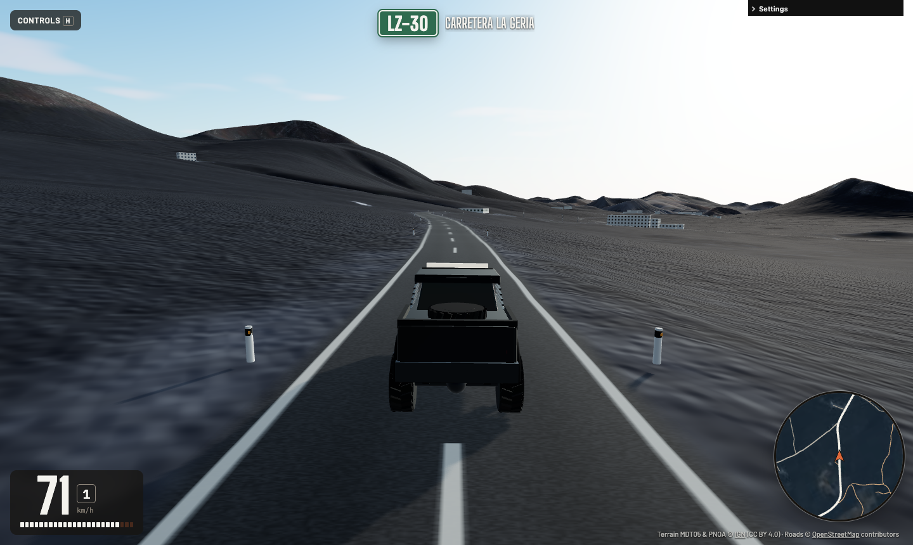
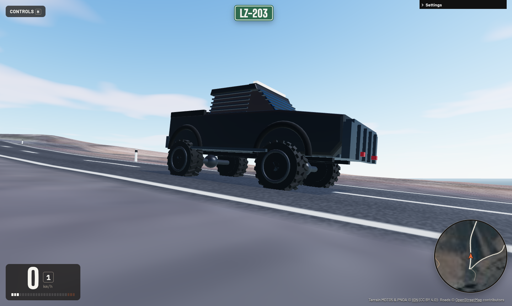
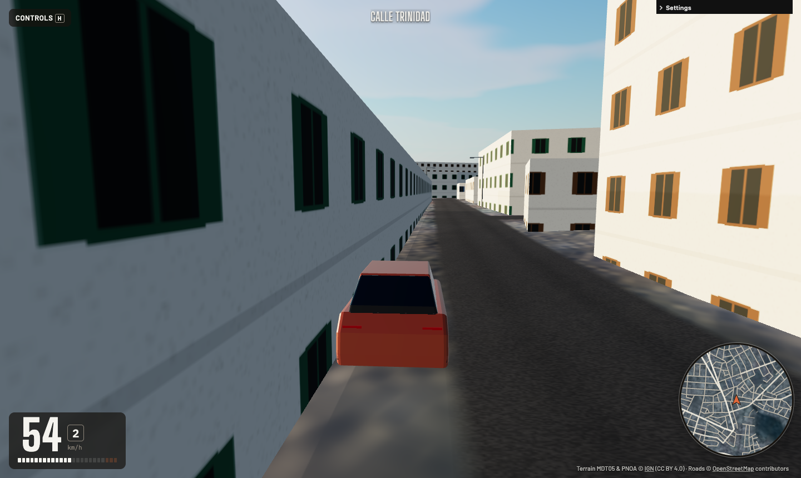
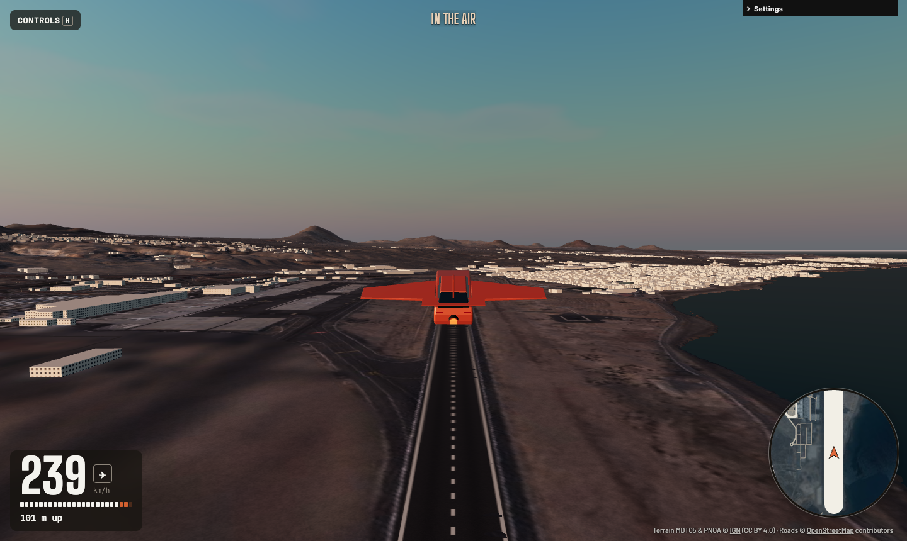

# Lanzarote Drive

[](https://github.com/iloire/driving-sim/actions/workflows/ci.yml)

A browser driving simulator over the real island of Lanzarote: the IGN 5 m terrain and aerial photo
used by [Famara Glide](https://github.com/iloire/paragliding-sim), with every OpenStreetMap road on
the island carved into it. You can drive the LZ-67 through Timanfaya, wind along La Geria, or leave
the road and bounce across the lava. Or press **F**: the car unfolds its wings and takes off.
Lanzarote Airport's runway is one of the places to start.

It runs in a desktop browser, or on a phone held sideways. Nothing to install.



## What's in it

- **The whole island at 5 m**: 105 detail tiles (3 km each) with a 1.5 m/px orthophoto, loaded as
  you drive and freed behind you.
- **Real roads**: about 13,000 OSM ways. Paved roads are graded and carved flat into the terrain,
  and drawn with Spanish markings. Dirt tracks are left to the photo, and so is everything off-road.
- **An armoured 4×4**: a matte-black, gunmetal-plated pickup on 1 m tall lug tyres, with a lift
  kit, solid axles, a ram bar, slatted guards over the glass, a roof light bar and a spare in the
  bed. It has a 520 N·m V8 and 50/50 four-wheel drive, and its all-terrain tyres keep their grip
  on picón and gravel.
- **A car that is a rigid body**: four raycast struts, tyres with a slip-angle curve and a friction
  circle, a torque curve and an automatic six-speed. Weight transfer, power oversteer, handbrake
  turns and rollovers all come out of the physics.
- **Towns**: about 27,500 OSM buildings, extruded with flat roofs, lime-white walls and green, blue
  or brown woodwork, as the island's building rules have it. They are solid, so you can crash into
  them. Street lamps line the roads through town, and white-and-black edge posts line the main
  roads in the open.
- **It flies**: press **F** and wings rise from the roof edges and swing out to an 8.4 m span, a
  fin and tailplane grow from the bed, and a jet lights under the rear bumper. It's a light plane
  from then on: lift and drag from the angle of attack, a stall past about 15°, a tail that keeps
  it pointing into the airflow, and controls that go soft as it slows. Fold the wings in the air
  and it falls like a car.
- **Surfaces**: tarmac grips, gravel tracks slide, and picón and lava slide more.
- **The road you're on** as a sign plate, a heading-up map, and sound for the engine and tyres.
- **Time of day**: from sunrise to sunset, with the sun where it really is over Lanzarote today.







## Run it

```bash
npm install
npm run dev        # http://localhost:5173
```

| Key | Does |
|---|---|
| **W / ↑** | Accelerate |
| **S / ↓** | Brake, and reverse once stopped |
| **A / D** or **← / →** | Steer |
| **Space** | Handbrake |
| **F** | Transform: unfold the wings (the jet comes on), or fold them back |
| **R** | Back on the nearest paved road, facing the way you were going |
| **M** · **N** | Pick a place to start · next place |
| **C** | Camera: chase, bonnet, orbit (drag the mouse) |
| **G** · **V** · **P** · **H** | Map · mute · pause · help |

**In the air** the same keys fly it. **W / S** push and pull the stick (S pulls the nose up),
**A / D** roll, and **Q / E** work the rudder. The jet sits at cruise thrust, **Shift** gives full
thrust and **Ctrl** idles it. To take off, transform, let it run past about 160 km/h, and pull **S**.

**Gamepad** (standard mapping): RT throttle, LT brake, left stick steers, A/B handbrake, X transform,
Y camera, Back reset, Start pause. In the air the left stick is the stick, RT boosts, LT idles, and
LB/RB are the rudder.

**Phone**, held sideways: slide the left thumb sideways to steer. Push the right thumb up to
accelerate, and pull it down to brake or back up.

The settings panel sets the solar time and the drivetrain (4×4 50/50, RWD, FWD).

A link starts someone at the same place and time: `?spawn=timanfaya&time=17:30`. The places are
`timanfaya`, `airport`, `mirador`, `famara`, `haria`, `la-geria`, `el-golfo`, `arrecife`, `teguise`,
`playa-blanca` and `orzola`.

## Check it

```bash
npm test           # car physics, flight, road carving, buildings, street furniture, terrain, sun, touch (Vitest)
npm run lint
npm run build      # typecheck + production bundle
```

CI runs all three on every push to `main` and on every pull request.

## Terrain and roads

`public/sites/lanzarote/` holds what the game loads. `npm run fetch-terrain -- lanzarote` builds
it: the IGN heightmap and photo, the 5 m tiles, and the OSM roads from Overpass, which it then
carves into the tiles. It also writes each tile's OSM buildings, street lamps and edge posts to
`objects/<col>_<row>.json`. Downloads are cached in `cache/` (git-ignored), so re-carving after a change
to the road model happens offline. `--refresh` downloads everything again. See
[docs/architecture.md](docs/architecture.md), and [docs/performance.md](docs/performance.md) for how
it stays fast.

## Deploy

Not deployed yet: GitHub Pages needs a public repo on this plan, and hosting is still to be decided.
Run it locally with `npm run dev`. CI runs the tests, lint and production build.

## Licence

The code is free for non-commercial use under a [custom licence](LICENSE); commercial use (selling it,
paid installations or services, ads) needs a separate licence from the author. The terrain data (MDT05 and PNOA) is © [Instituto Geográfico Nacional](https://www.ign.es),
CC BY 4.0. Road data © [OpenStreetMap contributors](https://www.openstreetmap.org/copyright), ODbL.
