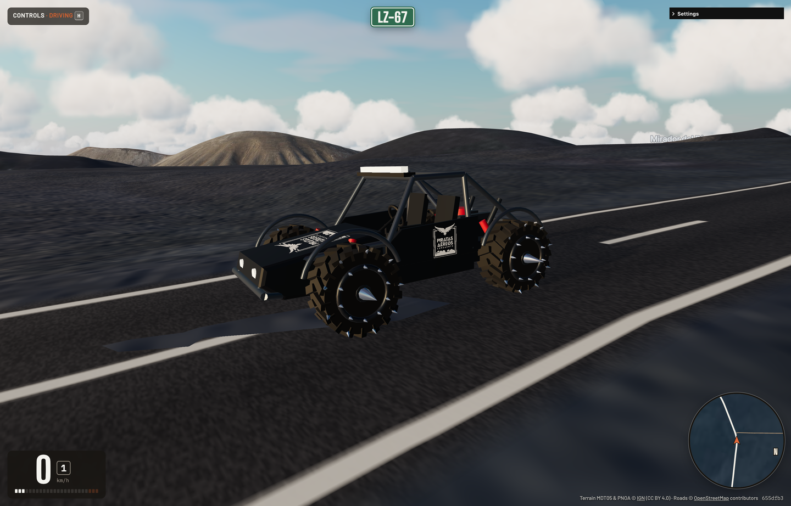
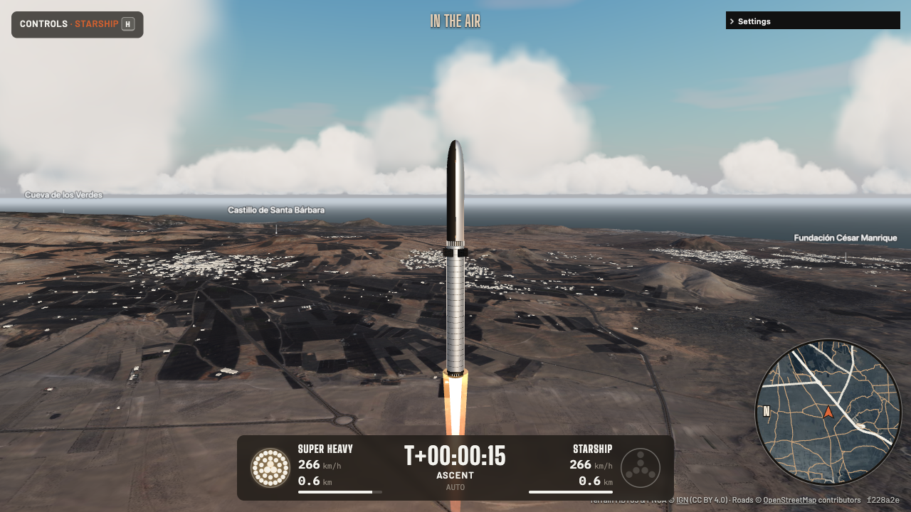

# Driving Sim

https://github.com/user-attachments/assets/6201258c-3a50-472c-bdfe-7c36c5b83674

[](https://github.com/iloire/driving-sim/actions/workflows/ci.yml)

### ▶ Play it now: **[https://iloire.github.io/driving-sim/](https://iloire.github.io/driving-sim/)**

A browser driving simulator over real places in Spain: IGN 5 m terrain and aerial photo (as in
[Famara Glide](https://github.com/iloire/paragliding-sim)) with every OpenStreetMap road carved in.
Four zones: **Lanzarote**, **Tenerife**, **Zaragoza** and **Benasque** (`?site=tenerife`). Drive the
LZ-67 through Timanfaya, go off-road across the lava, or press **F** to take off.

Runs in a desktop browser or on a phone held sideways. A welcome screen, set out as a rally roadbook, picks
zone, place and vehicle; **M** / **Esc** brings it back.


## What's in it

- **Real terrain**: 5 m tiles with a 1.5 m/px orthophoto, streamed as you drive.
- **Real roads**: ~13,000 OSM ways; paved ones graded, carved flat and marked Spanish-style.
- **Rigid-body car physics**: raycast struts, slip-angle tyres, torque curve, six-speed auto.
  Oversteer, handbrake turns and rollovers come out of the physics.
- **The Roadster** (`?car=roadster`): an electric wedge hypercar, 0–100 in ~2 s, ~390 km/h. **F** turns it into a
  hovering drone on floor thrusters.
- **The Buggy** (`?car=4x4`): a wide, low V8 desert buggy with an open roll cage, long-travel arms
  and spiked paddle tyres, wearing the Piratas Aéreos Lanzarote badge. Grips on gravel. **F** unfolds
  wings and a jet, and it flies like a light plane.
- **The Jet** (`?car=jet`, what a first visit starts in): a fly-by-wire delta fighter, up to 9 g (12 g past the limiter on the arrows) and Mach 1.2 on afterburner
  (Mach 2 up high). Sonic boom, contrails, vapour, pull-up warnings, g blackout and a fighter HUD.
- **Starship** (`?car=starship`, Lanzarote): Super Heavy and Ship on a launch tower in the sand of
  El Jable. Launch it, watch it stage, then bring the booster home and into the tower's chopsticks.
  The autopilot can fly the whole flight; touch the stick and it's yours. Whatever you're flying, a
  launch goes up from El Jable every few minutes.
- **Towns**: OSM buildings, solid, styled per zone (Lanzarote's white houses, Zaragoza's brick
  flats), lit at dusk, with street lamps and edge posts.
- **A living island**: trees, bushes, grass and rocks grow in round you, picked from the aerial
  photo (palms on Lanzarote, firs at Benasque, boulders on the lava); traffic on the roads and
  people on the pavements, both of which you can crash into; flocks of gulls overhead, and in the
  fields ahead ready to scatter.
- **Peak and sight labels** (**L**): Aneto, Teide, Mirador del Río …
- **Instant replay** (**I**): the last 30 seconds, crashes included.
- **Weather**: clouds you can fly through, with shadows that drift over the land. Each zone has its own:
  trade-wind cumulus, Tenerife's sea of clouds, calima, fog in the Benasque valley (`?wx=`, or Settings).
- **Surfaces, sound, map, road signs**, and the real sun position for any time of day.







## Run it

```bash
npm install
npm run dev        # http://localhost:5173
```

| Key | Does |
|---|---|
| **W / ↑** | Accelerate |
| **S / ↓** | Brake, and reverse once stopped |
| **A / D** or **← / →** | Steer |
| **Space** | Handbrake |
| **Shift** | Turbo; in the air, throttle up (afterburner at full) |
| **F** | Fly: Roadster thrusters, Buggy wings (again to land) |
| **L** · **I** | Labels · replay |
| **R** | Back on the nearest paved road |
| **M** / **Esc** · **N** | Menu · next place |
| **C** | Camera: chase, bonnet, orbit |
| **G** · **V** · **P** · **H** · **U** | Map · mute · pause · help · flight HUD |

**Hovering** (Roadster): Space climbs, Ctrl sinks, W/S tilt, A/D turn, Shift fires the tail nozzles.

**With wings** (Buggy, Jet): W/S pitch, A/D roll, Q/E rudder. WASD is the fine stick, arrows the hard
one (in the Jet they go past the limiter: 12 g, −6 g pushing, and a 250°/s roll). Shift/Ctrl move the throttle, 1–4 jump to idle/cruise/80 %/full; hold Shift at full for
afterburner. Space is the Jet's airbrake. The Buggy takes off past ~160 km/h with S.

**Starship**: Space starts the countdown (by hand, it lights or cuts the booster), W/S tip the
nose over or back, A/D tilt it sideways, Shift/Ctrl throttle, F autopilot on/off, T time warp
×1/×4/×10 up high. C cycles chase, a long-lens tracking camera and orbit.

**Gamepad**: RT/LT throttle and brake, left stick steers, A/B handbrake, X transform, Y camera,
stick click turbo, LB/RB rudder. **Phone**: left thumb steers, right thumb accelerates and brakes.

**Links**: `?spawn=timanfaya&time=17:30&car=jet`. Spawns: `timanfaya`, `airport`, `mirador`,
`famara`, `haria`, `la-geria`, `arrecife`, `teguise`, `orzola`. Pause and press **Share this
moment** to copy a link that drops someone into exactly where you are, e.g.
`?at=25256.0,11616.1,2.7,308,31&fly=1` (x, y, z, heading, km/h).

## Check it

```bash
npm test           # Vitest
npm run lint
npm run build      # typecheck + production bundle
```

CI runs all three on every push to `main` and every pull request.

## Terrain and roads

Each zone lives in `public/sites/<zone>/`, described by its `site.json`.
`npm run fetch-terrain -- <zone>` downloads the IGN data and OSM roads, builds the tiles and carves
the roads in; downloads are cached in `cache/` (`--refresh` to redo). See
[docs/architecture.md](docs/architecture.md) and [docs/performance.md](docs/performance.md).

## Deploy

GitHub Pages from CI: every green push to `main` deploys, then smoke-tests the live page, so a
green badge means that commit is live. Google Analytics 4 loads only if the repo variable
`GA_MEASUREMENT_ID` is set, and only after the player consents.

## Licence

Code: free for non-commercial use under a [custom licence](LICENSE); commercial use needs a
separate licence. Terrain (MDT05, PNOA) © [Instituto Geográfico Nacional](https://www.ign.es),
CC BY 4.0. Roads © [OpenStreetMap contributors](https://www.openstreetmap.org/copyright), ODbL.
