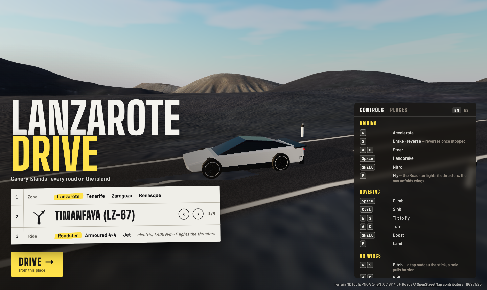
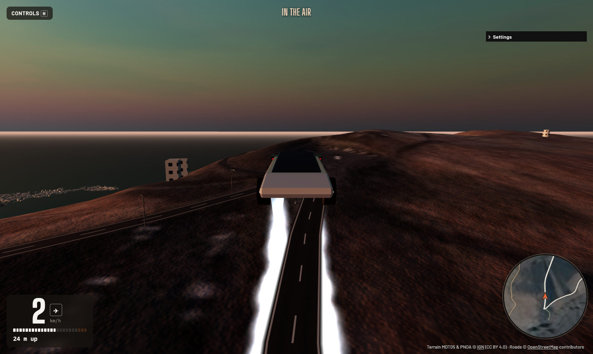

# Lanzarote Drive


https://github.com/user-attachments/assets/2760293f-edd4-4c84-ab65-bea412dab348


[](https://github.com/iloire/driving-sim/actions/workflows/ci.yml)

### ▶ Play it now: **[https://iloire.github.io/driving-sim/](https://iloire.github.io/driving-sim/)**

A browser driving simulator over the real island of Lanzarote: the IGN 5 m terrain and aerial photo
used by [Famara Glide](https://github.com/iloire/paragliding-sim), with every OpenStreetMap road on
the island carved into it. You can drive the LZ-67 through Timanfaya, wind along La Geria, or leave
the road and bounce across the lava. Or press **F**: the Roadster lights the gas thrusters in its
floor and lifts off like a rocket, and the armoured 4×4 unfolds wings and takes off from Lanzarote
Airport's runway.

It runs in a desktop browser, or on a phone held sideways. Nothing to install.

It opens on a welcome screen over the live island, with the camera circling your car. Pick a place,
a ride and the time of day, then **Drive**. **M** or **Esc** brings the menu back, with **Resume**.
A shared link skips the menu and puts you straight into the moment someone shared.




## What's in it

- **The whole island at 5 m**: 105 detail tiles (3 km each) with a 1.5 m/px orthophoto, loaded as
  you drive and freed behind you.
- **Real roads**: about 13,000 OSM ways. Paved roads are graded and carved flat into the terrain,
  and drawn with Spanish markings. Dirt tracks are left to the photo, and so is everything off-road.
- **The Roadster** (the default car): an original white wedge hypercar with a long glass canopy, a
  light bar across the nose and a red one across the tail, and four round nozzles in a black
  diffuser. It's electric: three motors give 1,400 N·m from a standstill through one gear, so
  0–100 km/h is down to the tyres (about 2 s) and it tops out near 390 km/h.
- **It hovers on thrusters**: press **F** and four nozzles drop out of the floor and blast gas
  straight down. Flight assists hold your height, so it flies like a drone. Space climbs, Ctrl
  sinks, W/S tilt it to fly forwards or back, A/D turn, and Shift fires the tail nozzles.
- **An armoured 4×4** (choose it under Settings → Vehicle, or `?car=4x4`): a matte-black, gunmetal-plated pickup on 1 m tall lug tyres, with a lift
  kit, solid axles, a ram bar, slatted guards over the glass, a roof light bar and a spare in the
  bed. It has a 520 N·m V8 and 50/50 four-wheel drive, and its all-terrain tyres keep their grip
  on picón and gravel.
- **A Jet** (Settings → Vehicle, or `?car=jet`): an original grey delta fighter that starts 600 m up and
  only flies. Fly-by-wire turns the stick into g (S pulls up to 9 g) and a roll rate (A/D), so it
  handles the same at any speed. Shift and Ctrl work a throttle lever. Dry, it tops out just under the sound barrier. Hold Shift at full and the
  afterburner pushes it through, with a vapour cone and a boom, on to about 1,470 km/h (Mach 1.2), which puts the
  island's whole length (about 60 km) under three minutes away. The air thins with height, so up
  high it's faster still (past Mach 1.5 at 11 km) and runs out of air near 18 km. Above 8 km it draws a
  contrail, hard turns pull vapour off the wingtips, and low and fast it kicks up dust or sea spray.
  The cockpit warns you: "whoop whoop, pull up" near the ground, a stall horn at the angle-of-attack
  limit, and the pilot's strained breathing as the g builds. Fly into the ground and it goes up in
  a fireball, with debris and smoke, before putting you back in the air. Space puts out the airbrake. A fighter HUD (flight path marker, pitch ladder,
  heading tape, g, PULL UP) draws over the view on wings. Hold too much g for too long and the view
  greys from the edges, the sound goes dull, and you black out for a few seconds; push hard and it reddens.
- **A car that is a rigid body**: four raycast struts, tyres with a slip-angle curve and a friction
  circle, a torque curve and an automatic six-speed. Weight transfer, power oversteer, handbrake
  turns and rollovers all come out of the physics.
- **Towns**: about 27,500 OSM buildings, one or two storeys with flat roofs, lime-white walls and
  green, blue or brown woodwork, as the island's building rules have it. Window styles, parapets,
  stepped upper floors, chimneys and roof rooms vary from house to house. They are solid, so you can crash into
  them. Street lamps line the roads through town, and white-and-black edge posts line the main
  roads in the open.
- **The 4×4 flies too**: press **F** and wings rise from the roof edges and swing out to an 8.4 m span, a
  fin and tailplane grow from the bed, and a jet lights under the rear bumper. It's a light plane
  from then on: lift and drag from the angle of attack, a stall past about 15°, a tail that keeps
  it pointing into the airflow, and controls that go soft as it slows. Fold the wings in the air
  and it falls like a car.
- **Balloon game**: about 40 big party balloons float 40–400 m over the island around you. Fly
  through one to pop it into confetti: 100 points plus a speed bonus, multiplied by a combo of up to
  ×5 when pops come within 4 s of each other. They show as dots on the map, and your best score is
  remembered in your browser. It's off until you press **B**. The settings panel can also turn it
on or start a new round.
- **Surfaces**: tarmac grips, gravel tracks slide, and picón and lava slide more.
- **The road you're on** as a sign plate, a heading-up map, and sound for the engine and tyres.
- **Time of day**: from sunrise to sunset, with the sun where it really is over Lanzarote today.




## Run it

```bash
npm install
npm run dev        # http://localhost:5173
```

| Key | Does |
|---|---|
| **W / ↑** | Accelerate |
| **S / ↓** | Brake, and reverse once stopped |
| **A / D** or **← / →** | Steer |
| **Space** | Handbrake |
| **Shift** | Turbo: a nitro rocket on the road (500+ km/h), tail thrusters hovering; on wings it opens the throttle, and the afterburner lights at full |
| **F** | Fly: the Roadster lights its thrusters, the 4×4 unfolds its wings (again to land as a car) |
| **B** | Balloon game on/off |
| **R** | Back on the nearest paved road, facing the way you were going |
| **M** / **Esc** · **N** | Menu (place, vehicle, time of day) · next place |
| **C** | Camera: chase, bonnet, orbit (drag the mouse) |
| **G** · **V** · **P** · **H** | Map · mute · pause · help |

**Hovering** (the Roadster): **Space** climbs and **Ctrl** sinks, and letting go holds your height.
**W / S** tilt the nose down or up to fly forwards or back, **A / D** turn, and **Shift** fires the tail
nozzles. On a phone the left thumb climbs and sinks.

**In the air with wings** (the 4×4 and the Jet) the same keys fly it. **W / S** push and pull the stick (S pulls the nose up),
**A / D** roll, and **Q / E** work the rudder. On keys the stick goes out gently: a tap is a nudge, and it reaches
full stick after about a second's hold. It snaps back when you let go. The jet has a throttle lever, starting at cruise (60 %):
**Shift** opens it, **Ctrl** closes it, and **1–4** jump to idle, cruise, 80 % and full. Keep holding **Shift** at
full to light the afterburner. On the Jet, **Space** is the airbrake. The HUD shows the throttle next to the height.
To take off in the 4×4, transform, let it run past about 160 km/h, and pull **S**.

**Gamepad** (standard mapping): RT throttle, LT brake, left stick steers, A/B handbrake, X transform,
Y camera, either stick click turbo, Back reset, Start pause. In the air the left stick is the
stick, RT and LT open and close the throttle, a stick click lights the afterburner, and LB/RB are the rudder. On a phone, hold BOOST.

**Phone**, held sideways: slide the left thumb sideways to steer. Push the right thumb up to
accelerate, and pull it down to brake or back up.

The welcome screen and the settings panel both swap the vehicle (Roadster, armoured 4×4 or Jet) and
set the time of day. The settings panel also has the exact solar time and the drivetrain (AWD, RWD, FWD).

**Balloons:** press **B** (BALLOONS on a phone) to fill the sky with them, take off (from the
airport, say), find the coloured dots on the map, and fly through them. Chain them for the combo.
Press **B** again to put them away.

A link starts someone at the same place and time: `?spawn=timanfaya&time=17:30` (add `&car=4x4`
for the truck, `&car=jet` for the Jet). The places are
`timanfaya`, `airport`, `mirador`, `famara`, `haria`, `la-geria`, `arrecife`, `teguise`
and `orzola`.

**Share a moment:** pause (**P**) and press **Share this moment**. That copies a link that starts the
car exactly there, with the same heading and speed, at the same time of day and in the same car,
in the air if you were flying. It opens already playing, so whoever opens it lands straight in the
drive. The link looks like `?at=25256.0,11616.1,2.7,308,31` (x, y and z in site metres, heading in
degrees, km/h) plus `&fly=1` in the air.

## Check it

```bash
npm test           # car physics, electric drive, hovering, wing flight, balloon game, road carving, buildings, street furniture, terrain, sun, touch (Vitest)
npm run lint
npm run build      # typecheck + production bundle
```

CI runs all three on every push to `main` and on every pull request.

## Terrain and roads

`public/sites/lanzarote/` holds what the game loads. `npm run fetch-terrain -- lanzarote` builds
it: the IGN heightmap and photo, the 5 m tiles, and the OSM roads from Overpass, which it then
carves into the tiles. It also writes each tile's OSM buildings, street lamps and edge posts to
`objects/<col>_<row>.json`. Downloads are cached in `cache/` (git-ignored), so re-carving after a change
to the road model happens offline. `--refresh` downloads everything again. See
[docs/architecture.md](docs/architecture.md), and [docs/performance.md](docs/performance.md) for how
it stays fast.

## Deploy

GitHub Pages, from CI. Every push to `main` that passes the tests is built with the
`/driving-sim/` base path and deployed. The deploy job then fetches the live page, the site file and
a detail photo, so a green badge means that commit is live.

Analytics: Google Analytics 4, only when the build gets a measurement ID. CI passes the repo
variable `GA_MEASUREMENT_ID` as `VITE_GA_ID` (`gh variable set GA_MEASUREMENT_ID --body G-XXXX`);
without it nothing loads. Storage stays denied until the player taps OK on the one-line chip.
Gameplay events live in `src/game/analytics.ts` and the `track(...)` calls in `src/main.ts`.

## Licence

The code is free for non-commercial use under a [custom licence](LICENSE); commercial use (selling it,
paid installations or services, ads) needs a separate licence from the author. The terrain data (MDT05 and PNOA) is © [Instituto Geográfico Nacional](https://www.ign.es),
CC BY 4.0. Road data © [OpenStreetMap contributors](https://www.openstreetmap.org/copyright), ODbL.
